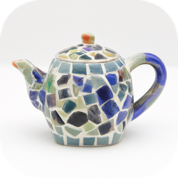

<p align="center">
  
</p>

<h1 align="center">Mozaic</h1>

<p align="center">
  A local image studio for the Mac: create, edit, crop and straighten images with two open models,<br>
  <b>Qwen Image 2.1</b> and <b>MOSS-Image</b>, on your own machine. AI agents can use it too, over MCP.
</p>

---

- **Everything runs locally.** No account, no cloud, no per-image cost. Your images stay in `~/Pictures/Mozaic`.
- **Self-contained.** One app. On first launch it installs its own engine and downloads the models, and
  you never deal with Python, ComfyUI or a terminal.
- **Two models, one switch.** Qwen Image 2.1 for generation and every kind of editing; MOSS-Image for
  generation with strong text rendering and layout-to-image. Only one is loaded at a time.
- **No filtering.** Neither model has a safety checker, and Mozaic adds no filtering or prompt rewriting.
- **Built for agents as well as people.** An MCP server lets Claude Code, Claude Desktop or any MCP client
  create and edit images, and their jobs show up live in the app.

## Install

**You need:** a Mac with Apple Silicon, macOS 14 or later, 32 GB of memory or more (it runs on less, but
slowly), and about 20 GB of free disk space for Qwen (plus about 20 GB more if you add MOSS-Image).

1. Download `Mozaic-<version>.dmg` and drag Mozaic to Applications.
2. Open it. The build isn't signed with an Apple Developer ID, so macOS blocks it the first time: go to
   **System Settings › Privacy & Security** and click **Open Anyway** (or run
   `xattr -dr com.apple.quarantine /Applications/Mozaic.app`).
3. The first launch sets up Python (about a minute), then shows a setup screen while it installs the
   engine (about 2 GB) and downloads Qwen Image 2.1 (about 17 GB) from Hugging Face. Downloads resume if
   interrupted and are checked against their SHA-256.

Picking **MOSS-Image** in the top bar the first time installs its MLX engine (about 0.4 GB) and downloads
its weights (about 20 GB).

If the model files are already on your Mac (from Comfy Desktop, for example), Mozaic hard-links them
instead of downloading: no download, no extra disk space, and Mozaic keeps working if the other app is
uninstalled.

## What it does

### Qwen Image 2.1

| Tool | What it's for |
| --- | --- |
| **Create** | Text to image at any aspect ratio up to native 2K, 1–8 images per run, and transparent PNGs from text. |
| **Edit** | Instruction editing with up to 10 images. `<image1>` is edited and `<image2>`… are references: outfit swaps, product placement, group shots from portraits, style transfer. |
| **Region** | Paint a mask (brush, eraser, rectangle, ellipse, lasso) and change only that area. Three methods: a red **outline** marked on the image, a separate **mask image**, or classic latent **repaint** with a strength slider. "Protect the rest" keeps every pixel outside the mask exact. |
| **Expand** | Crop, straighten and outpaint in one tool. Drag the edges in to crop or out to grow, pick an aspect, and straighten with a slider or by drawing a line along the horizon. Crops and straightens apply instantly at full resolution; only new canvas goes to the model, starting as a blurred stretch of the image, with the original pixels kept. |
| **Cut out** | Background removal, or "keep only the red car", with a real alpha channel. |
| **Remix** | Variations and upscaling (image to image with a strength slider, up to about 2048×2048). Restyling works best in Edit. |

### MOSS-Image

OpenMOSS's 5B text-to-image model, run with [moss-image-mlx](https://github.com/felix-ab/moss-image-mlx).
It only generates images (no editing), but it renders long text in English and Chinese well.

| Tool | What it's for |
| --- | --- |
| **Create** | Prompts up to 4K tokens with a real negative prompt, SFT or Base checkpoint, Turbo (about 6× faster, SFT only), steps / CFG / shift, LoRAs, 256² to 1456². |
| **Layout** | Draw text and object boxes on a canvas, and MOSS composes the image around them. |

SFT is the polished fine-tune; Base is the rawer, less curated pretrained model.

### The queue

Jobs run one at a time. While one is running, the Generate button becomes **Add to queue**, so you can
line up more images and edits while you wait, and the viewer stays on the job that's running. The
**Queue** button in the top bar shows what's running, everything waiting in order, and recent
results, with a cancel button on each job. Jobs queued by an AI agent wait in the same queue and are
marked **Agent**. Crops and straightens skip the queue: they're instant.

### And also

Live previews while Qwen samples, before/after compare, reuse any image's settings
with the seed locked, a library you can star, search and filter, drag-and-drop or paste images anywhere,
and LoRA support (anything in `models/loras`).

### Keys

| | |
| --- | --- |
| `⌘↵` run · `⌘N` new image · `⌘L` library · `⌘,` settings | `1`–`6` switch tools |
| `←` `→` browse · `S` star · `C` compare · `F` fit to window | Painting: `B` brush, `E` eraser, `R` rectangle, `O` ellipse, `L` lasso, `[` `]` size, `⌘Z` undo, space to pan |

## Speed

On an M1 Max (64 GB):

- **Qwen Image 2.1** (int8): about 10 s per step for a 0.5 MP image and about 15 s per step for edits,
  plus roughly a minute to load the model for the first job. A 512×512 image at 12 steps takes about
  75 seconds.
- **MOSS-Image**: a 1 MP image takes about 2½ minutes with Turbo and 12–15 minutes at the official
  50 steps.

When other apps fill the memory, macOS swaps the model out and steps can take minutes. **Settings ›
Free memory** unloads the models between sessions.

## Use it from an AI agent (MCP)

While Mozaic is open, its MCP endpoint is `http://127.0.0.1:47811/mcp`:

```bash
claude mcp add --transport http mozaic http://127.0.0.1:47811/mcp
```

Or over stdio, which also works when Mozaic is closed: it starts a headless Mozaic that quits after
30 idle minutes. **Settings › MCP** shows the exact command for your install, and for the app it is:

```bash
claude mcp add mozaic -- "$HOME/Library/Application Support/Mozaic/runtime/venv/bin/python" -m mozaic mcp
```

**Tools:** `generate_image` (with `model`: `qwen` or `moss`), `generate_layout` (MOSS), `edit_image`,
`edit_region`, `expand_image` (also crops and straightens), `remove_background`, `remix_image`,
`list_jobs`, `wait_for_jobs`, `get_job`, `cancel_job`, `list_images`, `get_image`, `import_image`,
`set_favorite` and `mozaic_status`, plus a `mozaic://guide` resource with prompting tips.

Image arguments take a library id, an absolute path, a URL or a data URI. Tools wait for the result,
sending progress notifications, and return file paths plus small previews.

### Batches and overnight work

An agent can queue many jobs at once by calling the tools with `wait: false`. Each call returns a job
id and its place in the queue straight away. `wait_for_jobs` then returns as soon as the next job
finishes, with its images, so the agent can review each result and queue fixes while the rest keep
running. `list_jobs` shows the queue, and `cancel_job` removes one job from it.

Over stdio, Mozaic can also tell an idle Claude Code session when a job it queued has finished, using
Claude Code's [channels](https://code.claude.com/docs/en/channels) (a research preview). Start Claude
Code with Mozaic's channel enabled (`mozaic` is the name you gave the server in `claude mcp add`):

```bash
claude --dangerously-load-development-channels server:mozaic
```

Each finished job then arrives in the session as a message with its job id, and Claude can pick up the
images and carry on, even overnight. Without the flag, everything else works the same, and agents use
`wait_for_jobs`.

## Where things live

- **Images:** `~/Pictures/Mozaic/YYYY-MM/`, with painted masks and other inputs in `.inputs/`.
  Deleting an image in Mozaic moves the file to the Trash.
- **Everything else** (engine, models, Python, index, thumbnails, settings and logs):
  `~/Library/Application Support/Mozaic/`.

**Uninstall:** delete Mozaic.app and `~/Library/Application Support/Mozaic`. Your images stay in
`~/Pictures/Mozaic`.

## Build from source

You need [uv](https://docs.astral.sh/uv/), Node.js and the Xcode command line tools.

```bash
scripts/build_app.sh
```

This builds `dist/Mozaic.app` and `dist/Mozaic-<version>.dmg`. The app carries the backend source, the
web UI and the uv installer; everything else is installed on first launch, so the `.dmg` is about 20 MB.

To ship a signed, notarized build:

```bash
MOZAIC_SIGN_ID="Developer ID Application: Your Name (TEAMID)" MOZAIC_NOTARY_PROFILE=mozaic scripts/build_app.sh
```

`MOZAIC_NOTARY_PROFILE` is a profile saved with `xcrun notarytool store-credentials`.

**Development:** `uv run mozaic serve` runs the server from source on http://127.0.0.1:47811, and
`npm --prefix web run dev` serves the UI with hot reload on :5178. `uv run python scripts/mcp_smoke.py http`
checks the MCP endpoint.

### Layout

- `src/mozaic/`: the Python backend.
  - `installer.py`: first-run engine installs and model downloads for both models, pinned in `engine/`.
  - `comfy.py`: runs and talks to ComfyUI.
  - `moss.py` and `moss_worker.py`: the MOSS engine and model switching.
  - `graphs.py`: the Qwen 2.1 workflows, built from ComfyUI core nodes.
  - `jobs.py`: the queue and operations.
  - `library.py`: the image library.
  - `imaging.py`: masks, outlines, cropping, straightening and compositing.
  - `server.py`: the HTTP API and events.
  - `mcp_server.py`: the MCP server.
- `web/`: the React UI.
- `macos/main.swift`: the native window.
- `scripts/`: build, icon and MCP smoke-test scripts.

## Licences

Mozaic's own code is released under the [MIT licence](LICENSE).

Mozaic ships none of the models or engines below in the app. Each user's Mac downloads them on first
use from their official sources, and each keeps its own licence. **Settings › Licences** lists them in
the app too.

| Component | Licence | Notes |
| --- | --- | --- |
| [Qwen Image 2.1](https://huggingface.co/Qwen/Qwen-Image-2.1) | [Qwen Research License Agreement](https://huggingface.co/Qwen/Qwen-Image-2.1/blob/main/LICENSE) | **Non-commercial research and evaluation only.** Commercial use needs a separate licence from the Qwen team. |
| [MOSS-Image](https://github.com/OpenMOSS/MOSS-Image) and its Turbo adapters | Apache-2.0 | Includes the Qwen3.5-9B text encoder (Alibaba Cloud) and the FLUX.2 VAE and small decoder (Black Forest Labs), both Apache-2.0. |
| [moss-image-mlx](https://github.com/felix-ab/moss-image-mlx) | Apache-2.0 | |
| [MLX](https://github.com/ml-explore/mlx) and mlx-lm | MIT | |
| [ComfyUI](https://github.com/Comfy-Org/ComfyUI) | GPL-3.0 | Downloaded from its official release and run as a separate program. |
| [PyTorch](https://github.com/pytorch/pytorch) | BSD-3-Clause | |

Qwen is licensed under the Qwen RESEARCH LICENSE AGREEMENT, Copyright (c) 2026 Hangzhou Tongyi
Laboratory Technology Co., Ltd. All Rights Reserved.

Mozaic is an independent project and is not affiliated with Alibaba, the Qwen team, OpenMOSS or Comfy Org.
